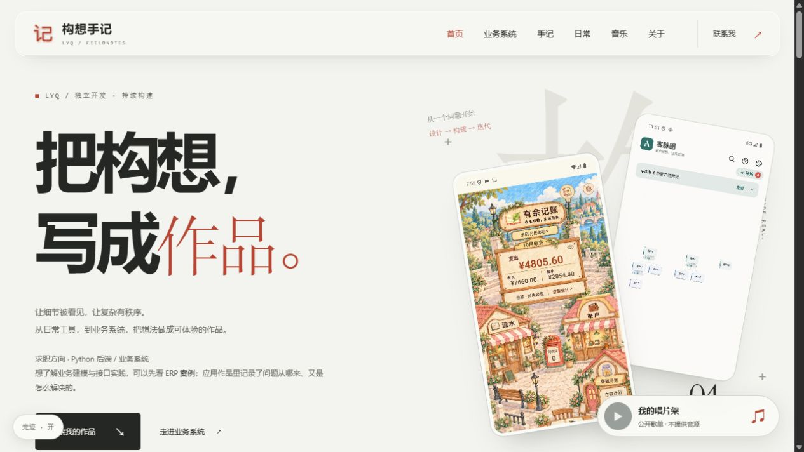
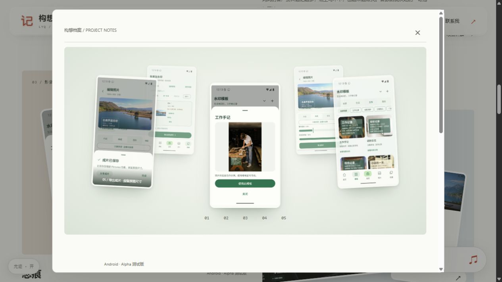
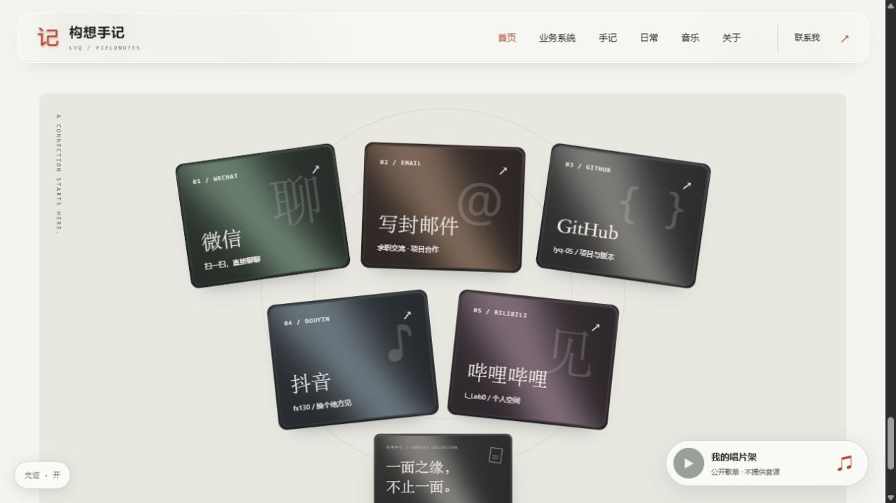
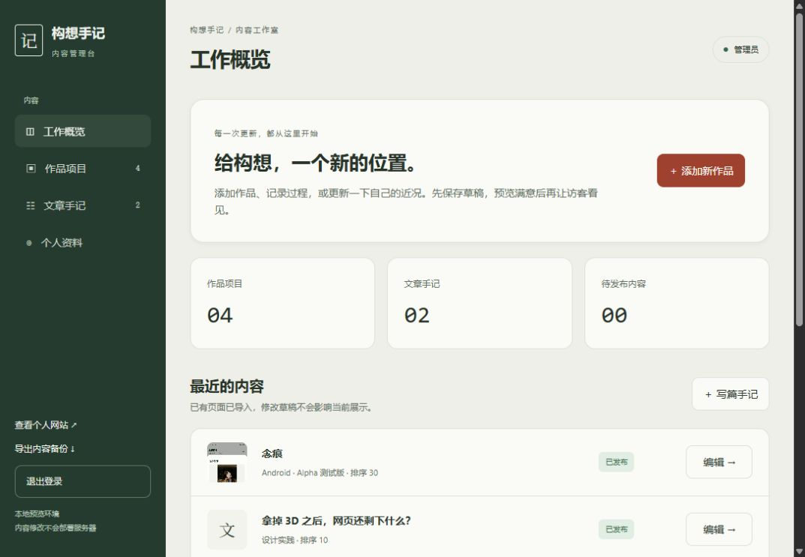

# 构想手记

  
  
  
  
  

<b>把构想，写成作品。</b> 一处展示作品、记录开发，也留一点生活的个人空间。

构想手记是我的个人作品网站。首页优先展示应用作品、业务系统案例与联系方式；开发手记和运动、番剧、音乐收藏拥有独立页面，方便不同目的的访客找到自己想看的内容。

它也有一个本地内容管理台：作品介绍、图片和文章可以先存草稿、预览，再明确发布。线上使用静态快照，编辑与对外展示分开，避免未完成内容直接出现在官网。

> **当前版本：v1.0.0 · 首个公开作品版本**（2026-10-29）  
> [本版详情](docs/RELEASE_v1.0.0.md) · [更新记录](CHANGELOG.md)

---

## 在线体验

| 平台 | 入口 | 说明 |
| --- | --- | --- |
| Web | **[打开构想手记 ↗](https://lyqdev.cn/)** | 无需安装、无需访客账号 |
| 业务案例 | [序工 ERP 案例](https://lyqdev.cn/projects/erp) | 公网展示流程与技术取舍；操作演示仅本地开放 |
| 开发记录 | [阅读手记](https://lyqdev.cn/notes) | 记录设计选择、业务建模与开发思考 |

网站不提供安装包；[Releases](https://github.com/lyq-05/gouxiang-notes/releases) 记录阶段性更新。浏览器访问即可，后续更新无需安装或覆盖文件。

---

## 界面一览

| 首页 · 作品优先 | 项目 · 悬浮画廊 |
| :---: | :---: |
|  |  |
| 联系 · 可展开卡包 | 内容管理台 · 仅本地 |
|  |  |

前三张为正式站点截图；管理台为本地界面。画廊中的内容来自我自己的应用作品。

## 从什么问题开始

早期个人网站尝试过较重的 3D 展示，但加载等待影响了浏览。新版本把重点放回文字层级、页面节奏和可控的动态效果，让访客先看到作品，再决定是否深入了解。

另一个问题是内容不断增加：作品经历、个人爱好、长篇文章全部塞进首页，会让页面失去重点。因此首页承担导览，详细内容进入独立页面；图片多的项目用自动环绕画廊组织，点击后再展开查看。

---

## 功能与体验

| 模块 | 可以看到或完成什么 |
| --- | --- |
| 作品展示 | 浏览有余记账、客脉图、念痕和个人工作台；阅读灵感来源、实现思考和项目状态 |
| 多图画廊 | 图片自动环绕，悬停卡片暂停，点击放大查看对应界面 |
| 视觉交互 | 首屏文字进场、滚动揭示、圆形转场、鼠标光迹、边缘高亮与金属反射卡片 |
| 联系卡包 | 展开微信、邮箱、GitHub、抖音和 B 站卡片，进一步查看信息或跳转 |
| 日常与手记 | 独立浏览运动、番剧、音乐收藏及开发文章 |
| 音乐收藏 | 按歌手筛选、搜索、标记喜欢；公网不提供歌曲音源 |
| 本地管理台 | 维护作品、文章、个人资料和图片；草稿、预览、发布及内容备份 |

## 实现与取舍

| 部分 | 实现方式与边界 |
| --- | --- |
| 前端 | 原生 HTML / CSS / JavaScript；CSS 空间变换与 Canvas / WebGL 动效结合，未以整页 3D 场景或视频背景作为视觉基础 |
| 内容服务 | Python / FastAPI、SQLite 本地 CMS，管理会话校验与显式发布 |
| 公网部署 | 发布内容导出为静态页面，由 Nginx + HTTPS 提供访问，保留前一版本用于回滚 |
| 使用体验 | 响应式布局、减少动态效果适配、可关闭光迹；实际流畅度仍取决于设备和浏览器 |
| 业务系统 | 同一工程保留制造业 ERP 原型，使用 FastAPI / SQLAlchemy，支持 SQLite 演示和 PostgreSQL 配置；不将其描述为已投产系统 |

动效中使用和适配了 React Bits 等组件思路与实现；项目介绍不将第三方效果宣称为全部从零原创。完整源码保留第三方已有的说明与许可文件。

---

## 数据与访问说明

- 访客浏览无需注册。音乐喜欢记录保存在当前浏览器，清理浏览器数据后可能丢失，不跨设备同步。
- 公网没有上传 MP3，也不提供这些歌曲的在线播放。选择本机音频试听不会上传音频文件。
- 管理台、管理员数据库与 ERP 操作接口没有对公网开放。ERP 业务数据为演示样例。
- 联系方式由本人公开展示；点击社交主页后由对应平台处理访问。

## 常见问题

**可以看源码或下载部署包吗？**  
本仓库用于作品展示，不公开源码或服务器部署包。可直接访问网站体验。

**为什么音乐页不能直接播放这些歌曲？**  
当前公开版只展示收藏和喜欢功能，未提供公开音源；本机文件试听是独立的本地功能。

**后台截图为什么没有在线入口？**  
管理台用于本人在本地编辑内容。修改确认后导出并发布，访客无法修改站点。

**所有动效都能在每台设备上一样流畅吗？**  
不能保证。不同 GPU 和浏览器合成表现有差异；页面提供减少动态效果适配和光迹开关。侧边浏览器中的转场偶发闪烁仍是后续优化点。

---

## 版本历史

| 版本 | 主题 |
| --- | --- |
| [v1.0.0](docs/RELEASE_v1.0.0.md) | 作品网站上线，独立内容页、本地管理台与交互动效 |

[完整更新记录](CHANGELOG.md) · [GitHub Releases](https://github.com/lyq-05/gouxiang-notes/releases)

## 项目说明

个人持续迭代项目，由我提出需求、选择设计方向与验收，并使用 AI 辅助开发。这个仓库只保存介绍、界面截图与版本说明；源码独立私有保存。截图内第三方作品、人物和品牌相关权益归各自权利人，不作为素材包分发。

[访问网站](https://lyqdev.cn/) · [我的其他项目](https://github.com/lyq-05)
